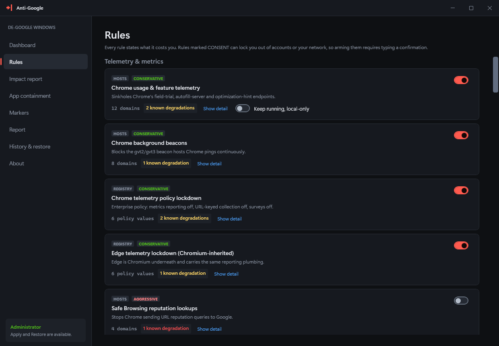
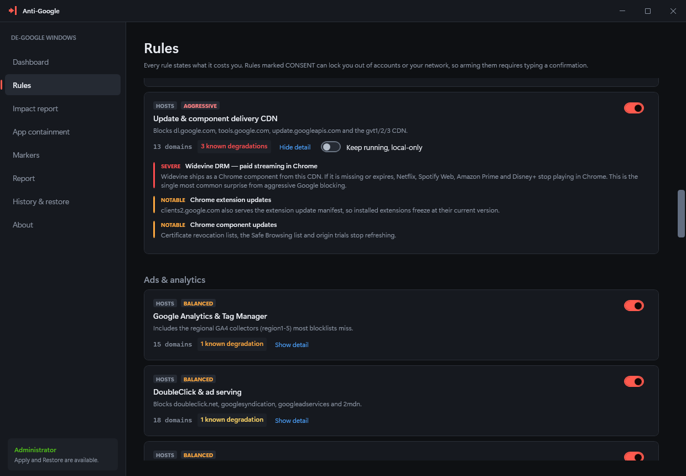
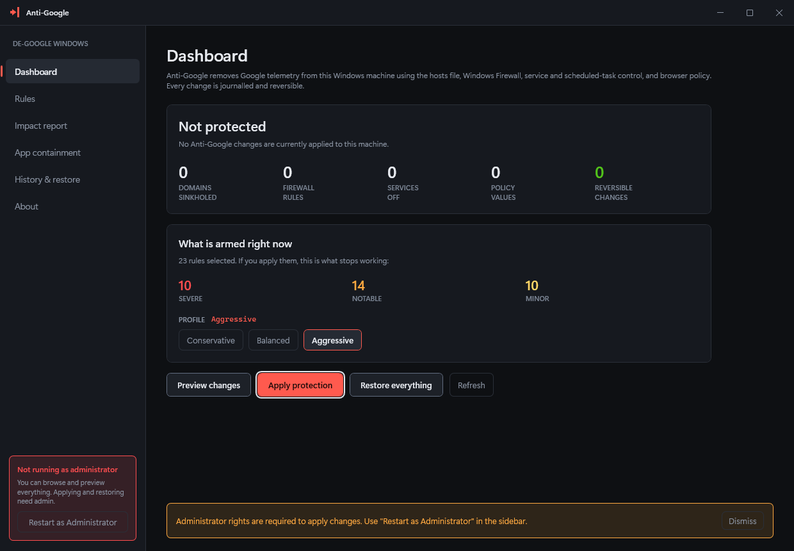

<div align="center">


# Anti-Google

**Strips Google telemetry out of Windows — and tells you, in plain language, exactly what that costs you before it does anything.**

[](https://github.com/dboudreau00/AntiGoogle/actions/workflows/ci.yml)
[](https://github.com/dboudreau00/AntiGoogle/releases)
[](LICENSE)
[](https://dotnet.microsoft.com/)
[](#)

</div>

---

<div align="center">

</div>

---

## The point

Most "block Google" tools hand you a list of domains and wish you luck. When your bank's login page
stops working three weeks later, nothing connects that to the hosts file you edited.

Anti-Google inverts that. Every rule declares what it breaks, at what severity, in words you can act
on. The **Impact report** is the primary screen, not a footnote — you cannot apply anything without
first seeing the full degradation list.

> **Severe — Widevine DRM: paid streaming in Chrome**
> Widevine ships as a Chrome component from this CDN. If it is missing or expires, Netflix, Spotify
> Web, Amazon Prime and Disney+ stop playing in Chrome. This is the single most common surprise from
> aggressive Google blocking.

That is a real entry from the catalog. All 23 rules read like that.

<div align="center">

<br /><em>The Impact report opens with a verdict, then everything that breaks, worst first, each citing the rule that causes it.</em>
</div>

---

## Install

Grab the latest build from [**Releases**](https://github.com/dboudreau00/AntiGoogle/releases). It is a
single self-contained `.exe` — no .NET runtime needed, no installer, nothing written outside
`%ProgramData%\AntiGoogle`.

**It is unsigned.** SmartScreen will warn on first run, and Smart App Control may block it outright.
Verify the SHA-256 against `SHA256SUMS.txt` in the release, or build it yourself — the whole point of
a tool like this is that you do not have to take anyone's word for it.

---

## Four enforcement layers

Each is independent and separately reversible.

| Layer | What it does | Blind spot |
|---|---|---|
| **Hosts file** | Sinkholes domains to `0.0.0.0` **and** `::` | No wildcards; DoH walks straight past it |
| **Windows Firewall** | Outbound blocks by IP range and by program | Blunt — cannot tell telemetry from anything else |
| **Services & tasks** | Disables Google updater services and scheduled tasks | Records prior start type; restores exactly |
| **Registry policy** | Chrome/Edge enterprise policy values | Shows as "managed by your organization" in Chrome |

**On hosts semantics:** a hosts entry matches one exact name. Listing `googleapis.com` does *not*
block `fcm.googleapis.com`. Every subdomain that matters is enumerated by hand in
[`GoogleEndpoints.cs`](src/AntiGoogle.Core/Catalog/GoogleEndpoints.cs) — that is why those lists are
long and boring instead of clever.

**On DNS-over-HTTPS:** the `reg.chrome.doh` rule is load-bearing. Without it Chrome resolves names
through its own encrypted DNS and ignores every hosts entry this app writes. It is also an honest
*trade*, not a pure win: your DNS queries go back to plaintext, so your ISP can see them again. The
rule says so on its own card.

<div align="center">

<br /><em>Every rule shows its layer, its risk tier, and how many degradations it causes.</em>
</div>

<div align="center">

<br /><em>Expanded, a rule spells out each consequence and how bad it is.</em>
</div>

---

## The default profile is Aggressive

This build ships **armed**. 23 rules are enabled out of the box, blackholing `googleapis.com` and
`gstatic.com`. That breaks Google Fonts, some reCAPTCHA flows, Firebase push notifications,
Chromecast, and Android tooling. Nothing is written to your machine until you press **Apply** and
tick the confirmation, but the intent ships pre-loaded.

Two categories deliberately stay **off** even at Aggressive:

- **Content blocks** — Google Search, YouTube, Google sign-in. Removing telemetry is a different
  thing from removing your ability to use the web.
- **Safe Browsing** — disabling phishing and malware warnings is a security regression. You should
  opt into that deliberately, not inherit it from a profile.

Both, plus the IP-range sledgehammers, are gated behind a typed `ARM` confirmation.

<div align="center">

<br /><em>A rule that can lock you out of your network cannot be armed by a single click.</em>
</div>

---

## Getting back

The feature that matters most is the one that undoes everything.

Before any change is written, its **reverse** is recorded to a journal in
`%ProgramData%\AntiGoogle\journal.json` — the previous service start type, the previous registry
value (including "this value did not exist"), the firewall rules created, a timestamped hosts backup.
The journal is flushed to disk *before* the change is made, so killing the app mid-apply still leaves
a complete way back.

**Restore everything** replays it newest-first, then sweeps the `Anti-Google` firewall group as a
backstop in case the journal itself was lost.

Hosts revert **strips the managed block** rather than restoring the backup — restoring a stale backup
would silently discard hosts edits you made in the meantime. There is a test for that.

The journal lives in `ProgramData`, not your user profile, so another administrator can undo these
changes even if your account is gone.

<div align="center">

</div>

---

## Preview before you commit

Nothing reaches the OS that has not first appeared in a plan you have seen. **Preview** runs the
whole pipeline — preflight safety checks, rule resolution, change planning — and touches nothing.

<div align="center">

<br /><em>A dry run, unelevated: preflight found the real hosts file, confirmed the machine's DNS resolvers are not Google's, and refused every change because it is not running as administrator.</em>
</div>

Preflight refuses rather than warns where a rule would be catastrophic on *this* machine. The clearest
case: if `8.8.8.8` is your actual resolver, blocking Google's IP ranges takes away name resolution for
everything — so that rule is refused outright, not merely flagged.

---

## App containment

Scans for binaries that inherit Google's networking stack:

- **Google first-party** — Chrome, Drive, Earth, the updater
- **Chromium browsers** — Edge, Brave, Vivaldi, Opera
- **Embedded Chromium** — Electron and CEF apps that ship a whole Chromium inside and phone home
  under *their vendor's* name, not Google's

That third category is the interesting one. The tell is an `icudtl.dat` or `resources.pak` sitting
next to the executable — hard to fake, hard to miss. On a normal machine this turns up things like
OBS's browser plugin, Logitech's Options+ helper, and Razer's app engine.

Containing one writes a firewall rule scoped to that single executable. The rest of the machine is
untouched.

<div align="center">

<br /><em>Each hit shows the evidence it was flagged on, and its signing publisher.</em>
</div>

---

## It does not demand administrator rights to be looked at

The app runs **as-invoker**. It boots, scans and previews with no elevation at all; only Apply and
Restore need it, and there is an explicit button for that. A privacy tool that requires admin just to
be examined is asking for more trust than it has earned.

<div align="center">

</div>

---

## Build from source

```bash
dotnet build AntiGoogle.sln
```

```bash
dotnet run --project src/AntiGoogle.App
```

Produce the self-contained release binary:

```bash
./publish-windows.ps1
```

### Tests

```bash
dotnet test
```

39 checks, covering the catalog's own invariants, the journal, and — the ones that matter — a full
`BuildPlan → Apply → RevertAll` round trip asserted **byte-identical** for the hosts file and exact
for registry values, plus proof that a reverse is journalled *before* each mutation, from both
directions.

There is a second runner:

```bash
dotnet run --project tests/AntiGoogle.Verify
```

It **links the same test source files** and executes the same `[Fact]`/`[Theory]` methods by
reflection. It exists because when **Smart App Control is enforced**, Windows blocks Microsoft-signed
`testhost.exe` from loading unsigned test assemblies (`0x800711C7`) and `dotnet test` silently
reports zero tests in every project. One copy of every assertion, two ways to run it.

---

## The mark


**"Null Route"** — an outbound data arrow driven hard to the right and arrested by a solid slab it
never reaches. The arrow is the telemetry beacon leaving your machine; the slab is the sink: the hosts
entry, the firewall rule, the disabled service. The gap between them is the actual subject. The packet
does not bounce and it does not pass. It stops, and nothing is drawn on the far side.

It deliberately refuses metaphor. It does not draw *protection* the way a shield or a padlock does —
it draws a flow and a hard stop, which is literally what all four layers do. For an app whose whole
pitch is that it will not overclaim, a mark that claims only "this specific thing was stopped" is the
honest one.

Defined once in [`Logo.xaml`](src/AntiGoogle.App/Logo.xaml) as vector geometry on a 64×64 viewbox,
pixel-hinted so every straight edge lands on a whole pixel at 16px. Regenerate the icon after any
change:

```bash
dotnet run --project tools/AntiGoogle.IconGen
```

That reads the same `Logo.xaml` the window uses, so the title-bar mark and the taskbar icon cannot
drift apart. Each size is rendered from the vector at its native resolution — downscaling one 256px
render to 16px turns crisp edges into grey mush, exactly where the icon works hardest.

---

## Layout

```
src/AntiGoogle.Core/          class library, no UI dependencies
  Model/                      BlockRule, Breakage, PlannedChange
  Catalog/                    the curated endpoint + rule data
  Engines/                    hosts, firewall, service, task, registry
  Journal/                    the undo log
  Safety/                     preflight checks
  Discovery/                  Chromium-derived binary scanner
src/AntiGoogle.App/           WPF UI
tools/AntiGoogle.IconGen/     renders Logo.xaml to the multi-resolution .ico
tests/AntiGoogle.Core.Tests/  xunit suite
tests/AntiGoogle.Verify/      console runner over the same sources
```

---

## Honest limits

- **The elevated Apply → Restore round trip has not been exercised against a real machine.** Service,
  scheduled-task and firewall mutation, HKLM writes, and the real hosts file's ACL path all need
  administrator rights, so the automated suite cannot reach them. Use a disposable VM for your first
  run.
- This reduces Google's reach. It does not make you anonymous, and it is no substitute for using a
  browser that does not report to Google in the first place.
- Software that ships its own DNS resolver bypasses the hosts layer. Only firewall IP rules catch it,
  and those are blunt enough to be off by default.
- The IP ranges are static. They are long-lived AS15169 allocations, but they are deliberately **not**
  fetched from `gstatic.com/ipranges/goog.json` at runtime — a privacy tool that phones Google to ask
  which addresses to block is self-defeating, and it would make behaviour depend on a file Google
  controls.
- On a domain-joined machine, Group Policy may fight or reapply these values, and your IT department
  may reasonably treat the changes as tampering. Preflight warns you; believe it.
- Disabling the Google updater means **Chrome stops getting security patches**. That is a real risk,
  not a footnote. Update it by hand or accept the exposure knowingly.
- Not audited. Reviewed adversarially, with an automated suite, but that is not the same thing.

---

## Contributing

See [CONTRIBUTING.md](CONTRIBUTING.md). The short version: **every rule must declare what it breaks**,
and a rule armed by default with an empty breakage list is a test failure.

## Security

See [SECURITY.md](SECURITY.md). Report privately. The bugs that matter most are the ones that leave a
machine in a state the user did not choose and cannot get out of.

## Licence

[GNU General Public License v3.0 or later](LICENSE).

Anti-Google is free software. You may redistribute and modify it under the GPL, and if you distribute
a modified version you must pass the same freedoms — and the source — on to whoever receives it. It
comes with absolutely no warranty.
